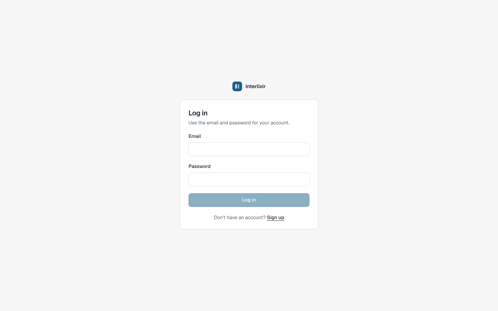
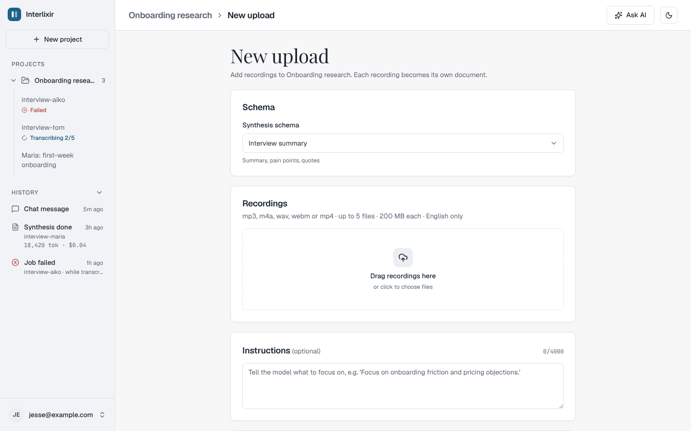
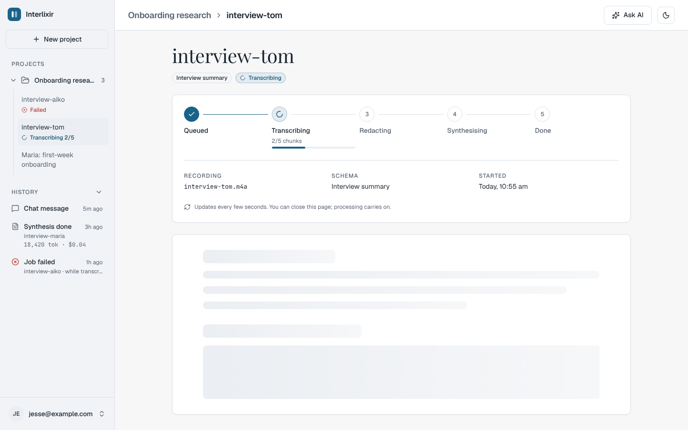
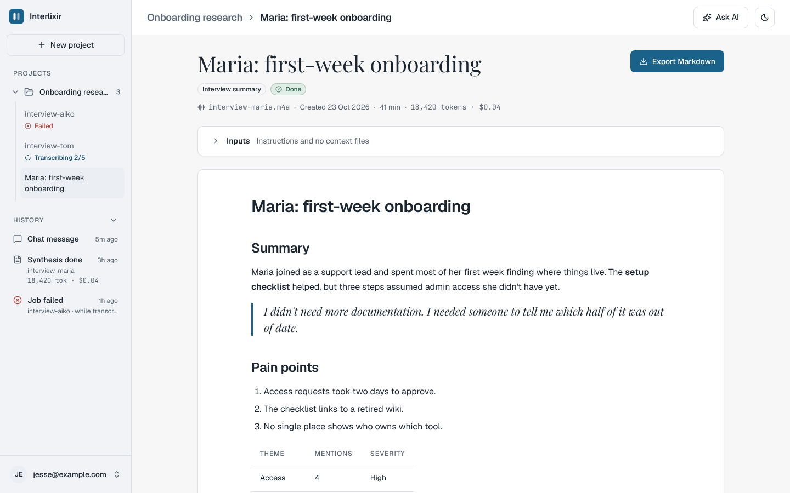
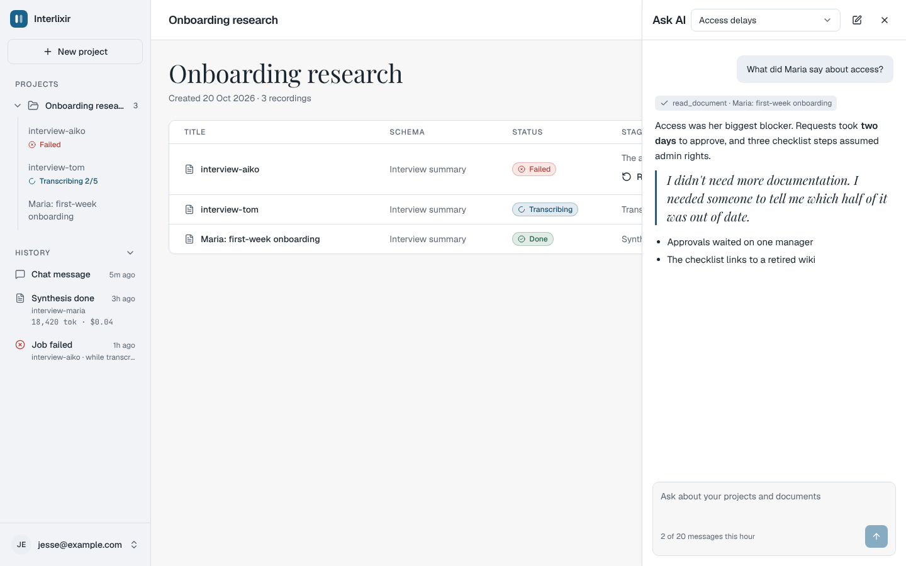
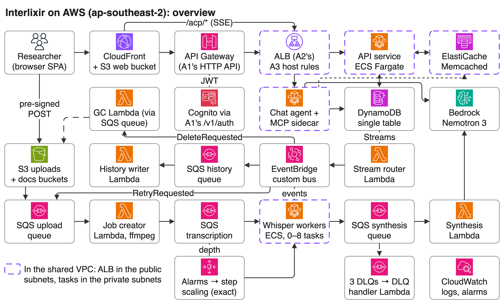

# Interlixir

A cloud service that turns English interview and usability-test recordings into structured Markdown research documents.












Recordings are uploaded straight to S3 and then run through an asynchronous, event-driven pipeline:

**chunk → transcribe (self-hosted Whisper on Fargate, scaling 0–8 on queue backlog) → merge → PII redaction → schema-driven synthesis (Amazon Bedrock) → document**

Users organise documents into projects, follow progress stage by stage, retry failures, export Markdown, browse an event history, and chat with a tool-using agent (MCP) over their own data.

> Built as a university cloud-computing project and shared as a portfolio piece. Resource names, account IDs and endpoints in this repo are placeholders (`interlixir-*`, `123456789012`, `*.example.com`). Replace them with your own before deploying.

## Architecture



- **API:** one FastAPI service on ECS Fargate, behind an HTTP API Gateway (JWT authorizer) and an ALB. Uploads go straight to S3 with pre-signed POST policies.
- **Pipeline:** S3 upload → job creator (Lambda, ffmpeg chunking) → SQS → Whisper workers (Fargate, auto-scaled on queue depth) → synthesis (Lambda, Bedrock) → Markdown document.
- **Events:** DynamoDB streams feed a stream router that publishes domain events to EventBridge. A history writer and a garbage collector subscribe, and failures end in `Failed` with a Retry through a dead-letter handler.
- **Chat agent:** a FastAPI service with an MCP server sidecar, using Bedrock tool use.
- **Web:** Vite + React + TypeScript + shadcn/ui single-page app, served from S3 through CloudFront.

## Repository layout

| Path | Contents |
| --- | --- |
| `services/` | One folder per deployable: API, job creator, Whisper worker, synthesis, stream router, history writer, dead-letter handler, GC, chat agent, MCP server, plus `shared/` (event, message and log contracts) |
| `web/` | The single-page app |
| `schemas/builtin/` | The six built-in synthesis JSON Schemas |
| `scripts/` | Schema checks, image build and push, SPA deploy, schema seeding |
| `.github/workflows/` | CI (tests with moto, no AWS access needed) and an opt-in `@claude` assistant |

## Running it

The infrastructure is created by hand in the AWS console (there is no IaC in this repo), and each service's `README.md` lists the settings it needs. Sign-in goes through an external auth service (Cognito behind an API Gateway) that is **not** part of this repository, so a full deployment needs you to supply a compatible one: set `COGNITO_USER_POOL_ID` and `COGNITO_APP_CLIENT_ID` and point `API_ORIGIN` at it.

You can run the tests and the SPA without any AWS account:

```sh
make help            # list targets
make check-schemas   # validate schemas/builtin/*.json
make venv-api && make test-api         # each service has venv-* and test-* targets
make dev-web         # SPA on http://localhost:5173
```

## License

[MIT](LICENSE)
